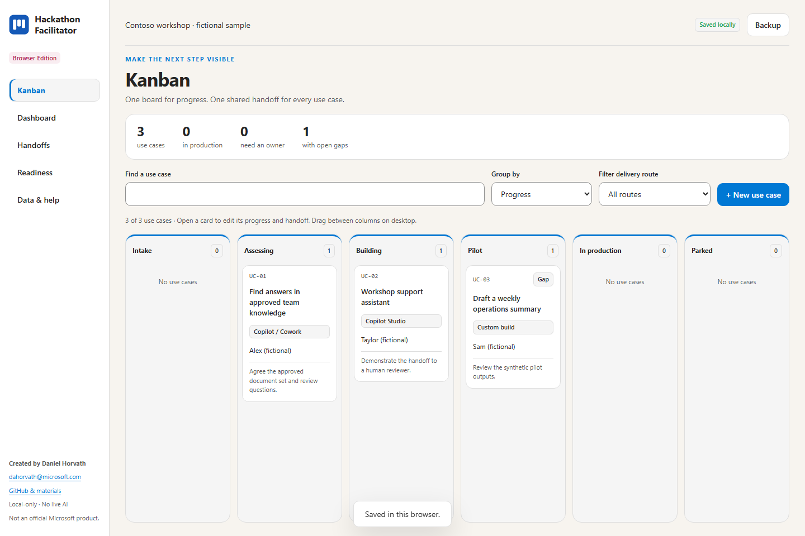

# Hackathon Facilitator

**Created by Daniel Horvath** · [dahorvath@microsoft.com](mailto:dahorvath@microsoft.com)

A local-first, Kanban-first browser workspace for AI hackathon use cases: make
progress visible, keep delivery routes separate, and leave every prototype with
an owner and a next action.

**Experimental local MVP, not an official Microsoft product or production service.**

## Open and use it now

### **[Open Hackathon Facilitator in your browser](https://horvathdaniel-2002.github.io/hackathon-facilitator-agent/)**

No download, installer, account, admin rights, Copilot subscription, Azure key or
server setup is required. It works in a current desktop or mobile browser. After
the first successful load, it can reopen offline; supported browsers can also
install it into a dedicated window or add it to the home screen.

The public browser edition includes Kanban, use-case intake, independent progress
and delivery routes, shared handoffs, readiness checks, dashboard counts and
JSON/CSV exports. Work stays in that browser profile; use **Backup** regularly.
[Usage, privacy, backup and feature-scope guide](browser/README.md).



*Fictional sample workspace. Manually recorded statuses do not imply
approval, deployment or a CAF submission.*

## Choose what you need

| I want to… | Start here | Required |
| --- | --- | --- |
| **Start organizing use cases now** | **[Open the Browser Edition](https://horvathdaniel-2002.github.io/hackathon-facilitator-agent/)** | A current browser; no account or installation |
| **Use it like an installed app** | Open the Browser Edition, then choose **Install app** or **Add to Home Screen** when offered | Supported browser; one initial online load |
| **Use the materials without installing anything** | [Word playbook](https://github.com/HorvathDaniel-2002/hackathon-facilitator-agent/raw/refs/heads/main/materials/Hackathon-Facilitator-Playbook.docx), [PowerPoint workshop](https://github.com/HorvathDaniel-2002/hackathon-facilitator-agent/raw/refs/heads/main/materials/Hackathon-Facilitator-Workshop.pptx), or [PDFs](materials/README.md) | Word/PowerPoint-compatible app, or a PDF viewer |
| **Use the Copilot agent** | Open the extracted repository in VS Code, then select **hackathon-facilitator** in Copilot Chat | Permitted GitHub Copilot access |
| **Run the larger developer version from source** | Clone/download this repository and follow the [developer setup](#full-local-web-app-developer-setup) | Node.js 24 and local development permissions |

The browser app and materials **do not require a Copilot subscription or Azure
API key**. Copilot access is needed only for the separate agent.

## End-to-end checked

The deployment workflow verifies the local data model and runs the complete
Browser Edition workflow in Chromium and Firefox before publishing. Coverage
includes first use, persistence, offline reopening, handoffs, readiness evidence,
production/CAF guards, backup/restore, CSV, multi-tab conflicts, failed storage,
keyboard cancellation, dark mode and responsive layouts from 320 to 1920 pixels.

[Browser deployment checks](https://github.com/HorvathDaniel-2002/hackathon-facilitator-agent/actions/workflows/deploy-browser.yml)
· [Full test report and explicit limitations](docs/end-to-end-validation.md)

## Windows distribution status

Windows installer and Microsoft Store distribution are **paused** because no
authorized Windows publisher has approved that release path. Historical unsigned
preview assets may remain attached to older releases for traceability, but they
are not the supported public entry point and should not be redistributed. Do not
bypass SmartScreen or organizational protections. The browser edition above is
the current public experience.

## Full local web app: developer setup

1. Install **Node.js 24**. Extract the ZIP into a normal writable folder.
2. **Windows:** double-click `Start-Hackathon.cmd` in the extracted root.
   **macOS/Linux:** open a terminal in the extracted folder and run:

   ```text
   node app/scripts/start-demo.mjs
   ```

3. Wait for dependencies and the fictional sample workspace to be prepared.
   The browser opens on the **Kanban board**. Keep the terminal open; **Ctrl+C**
   stops the app. Use the same launcher next time.

If you prefer npm, run `npm run demo` from the `app` folder.
[Detailed setup and troubleshooting](app/docs/local-demo-setup.md).

The launcher uses its own local synthetic-data database, mock AI and loopback-only
development sign-in. It does not reset another workspace, read your customer
database or configure any cloud service. Existing installations with older
schemas must use the [reviewed migration procedure](app/docs/kanban-workflow.md),
not an automatic reset.

## What changed

- **Responsive Kanban:** all progress columns fit across desktop screens;
  smaller screens use a responsive layout instead of a horizontally clipped board.
- **Kanban is home; Dashboard is optional.** Choose Dashboard in navigation for
  assessment charts and summaries.
- **Progress and delivery are independent:** Intake, Assessing, Building, Pilot,
  In production and Parked; group the same cards by Copilot / Cowork, Copilot
  Studio, Custom build, CAF or Unassigned.
- **One shared handoff:** open a card's side panel or the Handoff overview to
  edit owners, next action/date, results and evidence.
- **Evidence-backed records:** In production and Submitted to CAF require an owner
  and reference. Saving records something done elsewhere; it never deploys or
  submits to CAF.
- **Simpler navigation:** standalone Charter and Milestones have been removed.
  Workspace Settings retain names, membership and lifecycle controls.

## No-install materials

Use the Word workbook manually, lead a session with the PowerPoint speaker notes,
or read/print the PDFs. [Download guide](materials/README.md).
Save completed copies in your approved team location. The materials are reusable
templates, not automatic Office exports from the web app.

## Optional Copilot agent

The `.github/agents` profile works independently of the app. To add it to an
existing workspace with Node.js 24:

```powershell
node .\scripts\install-copilot-agent.mjs --target "C:\src\my-project"
```

The installer does not overwrite local customizations or install cloud services.
Use `/agent` in Copilot CLI, or the agent picker in VS Code.
[Agent installation guide](docs/copilot-agent-installation.md).

## Scope and sharing

Only reviewed source, fictional seed data, public references and reusable
materials are distributed. **No customer records, databases, credentials,
private screenshots or original local git history are included.**
Do not upload real data, completed plans or approval evidence to public issues,
commits or forks.

The demo uses synthetic identities, not Entra SSO; do not expose it on a network
or deploy it as a corporate service. Mock evaluation scores are fixtures, not
validated portfolio recommendations. Live-model quality, real corporate sign-in,
production operations and required approvals remain separate work.

Public availability is not Microsoft approval, program eligibility or an
open-source license grant. The [Microsoft hackathon submission](docs/official-hackathon-submission.md)
is still a draft, not a submitted/accepted entry.

[Report a problem using a synthetic example](https://github.com/HorvathDaniel-2002/hackathon-facilitator-agent/issues)
· [Copy-ready colleague message](docs/colleague-distribution.md)
· [Source and developer instructions](app/README.md)
