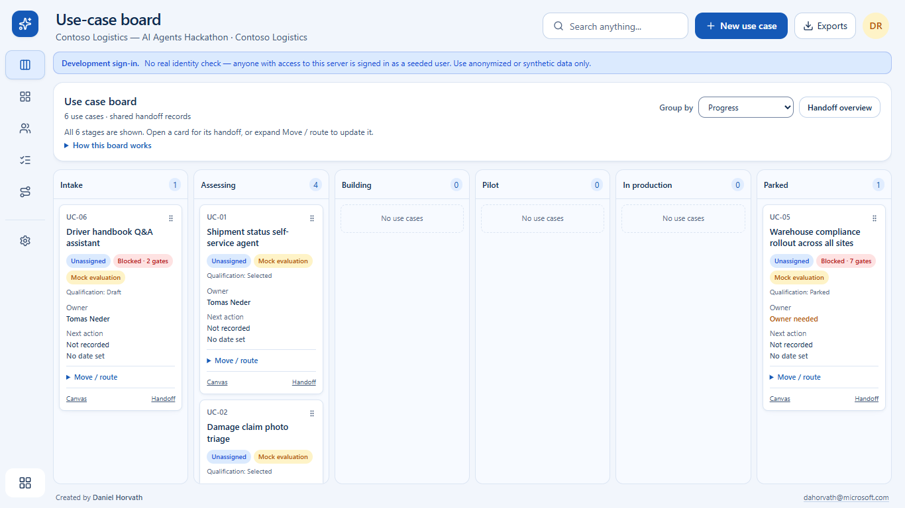

# Hackathon Facilitator

**Created by Daniel Horvath** · [dahorvath@microsoft.com](mailto:dahorvath@microsoft.com)

A full local, Kanban-first workspace for AI hackathon use cases: evaluate ideas,
generate mock build guides, make delivery progress visible, check readiness and
leave every prototype with an owner and a next action.

**Experimental local MVP, not an official Microsoft product or production service.**

## Full original application — portable local package

### **[Download the full portable application](https://github.com/HorvathDaniel-2002/hackathon-facilitator-agent/releases/download/v0.3.2-portable.1/Hackathon-Facilitator-Full-Portable-0.3.2.zip)**

This is the **complete application shown in the product walkthrough**, not the
reduced Browser Edition. It includes the full Kanban, use-case intake, contacts,
mock evaluator, mock build guides, readiness/runbook, shared handoffs, dashboard
and exports.

1. Download and extract the complete ZIP into a normal writable folder.
2. Open **Start-Hackathon-Facilitator.cmd**.
3. Keep the launcher window open while using the app in your browser.

The package automatically selects native Intel/AMD x64 or Windows ARM64 and uses
its included official Node.js runtime. No Store installation, admin rights,
separate Node.js/npm, Azure account, Copilot subscription or cloud AI key is
required. [Portable start, stop, data and backup guide](portable/README.md).



*Fictional sample workspace. Mock AI; statuses do not imply
approval, deployment or a CAF submission.*

## Choose what you need

| I want to… | Start here | Required |
| --- | --- | --- |
| **Use the complete original application** | **[Download the full portable ZIP](https://github.com/HorvathDaniel-2002/hackathon-facilitator-agent/releases/download/v0.3.2-portable.1/Hackathon-Facilitator-Full-Portable-0.3.2.zip)** | Windows x64/ARM64; extract and open one CMD file |
| **Try only the lightweight Kanban companion** | [Open the reduced Browser Edition](https://horvathdaniel-2002.github.io/hackathon-facilitator-agent/) | Current desktop/mobile browser; no AI evaluator or build guides |
| **Use the materials without installing anything** | [Word playbook](https://github.com/HorvathDaniel-2002/hackathon-facilitator-agent/raw/refs/heads/main/materials/Hackathon-Facilitator-Playbook.docx), [PowerPoint workshop](https://github.com/HorvathDaniel-2002/hackathon-facilitator-agent/raw/refs/heads/main/materials/Hackathon-Facilitator-Workshop.pptx), or [PDFs](materials/README.md) | Word/PowerPoint-compatible app, or a PDF viewer |
| **Use the Copilot agent** | Open the extracted repository in VS Code, then select **hackathon-facilitator** in Copilot Chat | Permitted GitHub Copilot access |
| **Run or modify the app from source** | Clone/download this repository and follow the [developer setup](#full-local-web-app-developer-setup) | Node.js 24 and local development permissions |

The full portable app, light browser companion and materials **do not require a
Copilot subscription or Azure API key**. Copilot access is needed only for the
separate agent.

## End-to-end checked

The exact universal portable package passed on native x64 and native ARM64:

- extraction and automatic architecture selection;
- protected numeric-loopback startup with upstream-signed Node;
- the complete original-app workflow, mock evaluation and build guide;
- production/CAF evidence guards, readiness, dashboard and exports;
- stop/restart with saved-data preservation; and
- explicit timestamped workspace backup.

[Native x64/ARM64 evidence](https://github.com/HorvathDaniel-2002/hackathon-facilitator-agent/actions/runs/39770207915)
· [Full test report and limitations](docs/end-to-end-validation.md)

## Distribution status

This route is a portable ZIP, not a Microsoft Store submission or installed
Windows product. Store and signed-installer publication remain paused because no
authorized Windows publisher approved those routes. Historical unsigned installer
assets are not the supported entry point. Device policy can still block downloaded
CMD or binary files; do not bypass Windows or organizational protections.

## Full local web app: developer setup

1. Install **Node.js 24**. Extract the ZIP into a normal writable folder.
2. **Windows:** double-click `Start-Hackathon.cmd` in the extracted root.
   **macOS/Linux:** open a terminal in the extracted folder and run:

   ```text
   node app/scripts/start-demo.mjs
   ```

3. Wait for dependencies and the fictional sample workspace to be prepared.
   The browser opens on the **Kanban board**. Keep the terminal open; **Ctrl+C**
   stops the app. Use the same launcher next time.

If you prefer npm, run `npm run demo` from the `app` folder.
[Detailed setup and troubleshooting](app/docs/local-demo-setup.md).

The launcher uses its own local synthetic-data database, mock AI and loopback-only
development sign-in. It does not reset another workspace, read your customer
database or configure any cloud service. Existing installations with older
schemas must use the [reviewed migration procedure](app/docs/kanban-workflow.md),
not an automatic reset.

## What changed

- **Responsive Kanban:** all progress columns fit across desktop screens;
  smaller screens use a responsive layout instead of a horizontally clipped board.
- **Kanban is home; Dashboard is optional.** Choose Dashboard in navigation for
  assessment charts and summaries.
- **Progress and delivery are independent:** Intake, Assessing, Building, Pilot,
  In production and Parked; group the same cards by Copilot / Cowork, Copilot
  Studio, Custom build, CAF or Unassigned.
- **One shared handoff:** open a card's side panel or the Handoff overview to
  edit owners, next action/date, results and evidence.
- **Evidence-backed records:** In production and Submitted to CAF require an owner
  and reference. Saving records something done elsewhere; it never deploys or
  submits to CAF.
- **Simpler navigation:** standalone Charter and Milestones have been removed.
  Workspace Settings retain names, membership and lifecycle controls.

## No-install materials

Use the Word workbook manually, lead a session with the PowerPoint speaker notes,
or read/print the PDFs. [Download guide](materials/README.md).
Save completed copies in your approved team location. The materials are reusable
templates, not automatic Office exports from the web app.

## Optional Copilot agent

The `.github/agents` profile works independently of the app. To add it to an
existing workspace with Node.js 24:

```powershell
node .\scripts\install-copilot-agent.mjs --target "C:\src\my-project"
```

The installer does not overwrite local customizations or install cloud services.
Use `/agent` in Copilot CLI, or the agent picker in VS Code.
[Agent installation guide](docs/copilot-agent-installation.md).

## Scope and sharing

Only reviewed source, fictional seed data, public references and reusable
materials are distributed. **No customer records, databases, credentials,
private screenshots or original local git history are included.**
Do not upload real data, completed plans or approval evidence to public issues,
commits or forks.

The demo uses synthetic identities, not Entra SSO; do not expose it on a network
or deploy it as a corporate service. Mock evaluation scores are fixtures, not
validated portfolio recommendations. Live-model quality, real corporate sign-in,
production operations and required approvals remain separate work.

Public availability is not Microsoft approval, program eligibility or an
open-source license grant. The [Microsoft hackathon submission](docs/official-hackathon-submission.md)
is still a draft, not a submitted/accepted entry.

[Report a problem using a synthetic example](https://github.com/HorvathDaniel-2002/hackathon-facilitator-agent/issues)
· [Copy-ready colleague message](docs/colleague-distribution.md)
· [Source and developer instructions](app/README.md)
